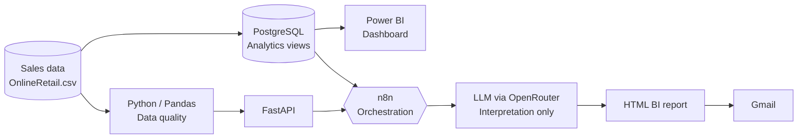
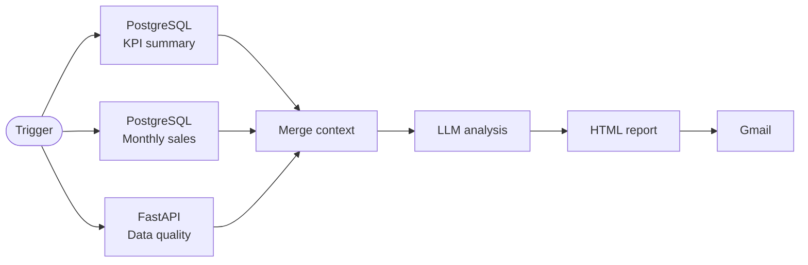

<div align="center">

# 🧠 Automated Business Intelligence Agent

**An end-to-end Data & AI Engineering solution for automated sales analytics, data quality monitoring and AI-assisted business reporting**

[](https://www.python.org/)
[](https://www.postgresql.org/)
[](https://fastapi.tiangolo.com/)
[](https://n8n.io/)
[](https://powerbi.microsoft.com/)
[](https://www.docker.com/)
[](LICENSE)

[Overview](#-overview) • [Architecture](#-architecture) • [Business KPIs](#-business-kpis) • [Getting Started](#-getting-started) • [Roadmap](#-roadmap)

</div>

---

## 📌 Overview

**Automated Business Intelligence Agent** turns raw transactional sales data into **reliable KPIs, interactive dashboards and automated management reports**, with Generative AI used strictly as an *interpretation layer*, never as a calculation engine.

Developed during an enterprise-oriented internship, the project addresses a recurring BI challenge: transforming large volumes of noisy transactional data into trustworthy, decision-ready insights with minimal manual effort.

### Highlights

| | |
|---|---|
| 📦 **541,909** | transactional records processed |
| 💰 **$10.66M** | revenue computed from validated sales |
| ⏰ **Weekly** | automated report, every Monday at 08:00 (Africa/Casablanca) |
| 🛡️ **0** | KPIs calculated by the LLM, all figures come from deterministic SQL/Python |

> This is the first milestone of a broader roadmap introducing a **Model Context Protocol (MCP)** server that exposes controlled business tools to an autonomous BI agent. See the [Roadmap](#-roadmap).

---

## 🧱 Architecture



### Design principle: separation of concerns

| Component | Responsibility |
|---|---|
| **Python / SQL** | Calculate and validate facts (deterministic) |
| **PostgreSQL** | Single source of truth for business metrics |
| **Power BI** | Visualize facts |
| **n8n** | Orchestrate the end-to-end workflow |
| **LLM** | Interpret facts, never compute them |
| **Gmail** | Distribute insights to stakeholders |

All metrics are computed with deterministic SQL and Python **before** reaching the AI layer, which works only on pre-validated numbers it cannot alter. This keeps the system auditable and trustworthy for business stakeholders.

---

## 🛠️ Tech Stack

| Layer | Technology | Role |
|---|---|---|
| Data processing | Python, Pandas | Data quality profiling |
| API | FastAPI, Uvicorn | Exposes analytics as HTTP endpoints |
| Database | PostgreSQL 16, SQL views | Storage, KPI definitions, business logic |
| Orchestration | n8n | Workflow automation and scheduling |
| Generative AI | OpenRouter (LLM) | Business insight generation |
| Visualization | Power BI | Interactive dashboard |
| Delivery | Gmail | Automated HTML report |
| Infrastructure | Docker Compose | Reproducible services |

---

## 🔍 Data Quality Layer

A dedicated Pandas component profiles the dataset **before** any analysis, so data issues are surfaced instead of silently propagating into KPIs.

| Check | Result |
|---|---:|
| Transaction lines | 541,909 |
| Source attributes | 8 |
| Non-positive quantities | 10,624 |
| Non-positive unit prices | 2,517 |
| Missing customer identifiers | 135,080 |
| Missing descriptions | 1,454 |

> Non-positive quantities or prices are **not** automatically treated as errors: they can be returns, cancellations or accounting adjustments. They are flagged for context rather than silently discarded.

The component is exposed through FastAPI so n8n can trigger it on demand:

```http
GET /data-quality
```

---

## 🗄️ PostgreSQL Analytics Layer

PostgreSQL is the **single source of truth** consumed by both Power BI and the reporting workflow, guaranteeing consistent KPIs everywhere. Raw records are always preserved: cleaning happens at the view level, never by mutating source data.

A commercial sales rule isolates valid sales from cancellations, adjustments and zero-price movements:

```sql
invoice_no ~ '^[0-9]'
AND unit_price > 0
AND quantity > 0
```

<details>
<summary><b>Analytical views</b></summary>

| View | Purpose |
|---|---|
| `valid_sales` | Validated sales transactions |
| `product_sales` | Sales aggregated by product |
| `kpi_summary` | Global business KPIs |
| `monthly_sales` | Monthly revenue, orders and average order value |
| `country_sales` | Performance by country |
| `product_performance` | Performance by revenue and quantity |

</details>

---

## 📊 Business KPIs

| KPI | Result |
|---|---:|
| Total Revenue | $10,655,622.48 |
| Total Orders | 19,959 |
| Average Order Value | $533.88 |
| Unique Identified Customers | 4,338 |

The layer also provides monthly revenue evolution, order-volume and average-order-value trends, and performance by country and product.

> ⚠️ **Data limitation:** the final month is incomplete, as transactions end on December 9, 2011. This is stated explicitly in both the dashboard and the AI-generated analysis to prevent misleading period-over-period conclusions.

### Power BI Dashboard

Power BI reads the PostgreSQL views directly. Visuals: Total Revenue, Total Orders, Average Order Value, Unique Customers, Monthly Revenue Evolution, Top 10 Countries and Top 10 Products by Revenue.

<!-- Add a screenshot:  -->

---

## 🤖 AI-Assisted Analysis & Automated Workflow

n8n runs manually or on a schedule (**every Monday at 08:00, Africa/Casablanca**), merging three trusted contexts before calling the LLM:



**LLM guardrails.** The model must:

- use **only** the supplied analytical data;
- preserve KPI values exactly as provided;
- never invent missing information or unsupported causal explanations;
- distinguish data quality issues from business performance;
- flag incomplete reporting periods.

**Report contents:** Business Summary, Monthly Evolution, Key Trends, Data Quality Summary, Analytical Caveats.

<!-- Add a screenshot of the n8n workflow and a sample report:  -->

---

## 🐳 Docker Environment

| Service | Role |
|---|---|
| `n8n` | Workflow orchestration |
| `postgres` | Analytical data store |
| `python-quality` | FastAPI + Pandas data quality service |

Docker Compose manages networking, persistent storage, ports, environment configuration and restart policies, so the whole stack is reproducible on any machine.

<details>
<summary><b>📂 Project structure</b></summary>

```text
automated-bi-agent/
├── data/                  # Transactional data (gitignored)
├── reports/               # Generated reports (gitignored)
├── scripts/
│   ├── api.py             # FastAPI application
│   └── data_quality.py    # Pandas data quality module
├── .env.example           # Environment variable template
├── Dockerfile.python
├── docker-compose.yml
└── requirements.txt
```

</details>

---

## 🚀 Getting Started

**Prerequisites:** Docker & Docker Compose, a free [OpenRouter](https://openrouter.ai/) API key, Gmail OAuth credentials (for report delivery)

```bash
# 1. Configure environment variables
cp .env.example .env
```

```env
POSTGRES_DB=bi_database
POSTGRES_USER=bi_user
POSTGRES_PASSWORD=change_me
OPENROUTER_API_KEY=your_api_key_here
```

```bash
# 2. Add the dataset at data/OnlineRetail.csv, then start the stack
docker compose up -d
```

| Service | URL |
|---|---|
| API health check | http://localhost:8000/health |
| Data quality report | http://localhost:8000/data-quality |
| n8n | http://localhost:5678 |

### 🔐 Security

Credentials are kept out of source code through environment variables. The repository never includes database passwords, OpenRouter keys, Gmail OAuth credentials or raw datasets.

---

## 🧭 Roadmap

The next phase introduces an **MCP-enabled BI agent** that queries business data through a controlled tool interface instead of direct database access.

```text
get_kpi_summary()      get_revenue()          get_sales_by_region()
get_sales_by_product() get_top_products()     compare_periods()
```

**Goal:** let the LLM decide which tools to call from a natural-language business question, while every data access point stays explicit, controlled and auditable.

A multi-agent setup (Data Quality, KPI, Analysis and Report agents) will be considered only if it brings measurable value over the single-agent design.

---

<div align="center">

### 👩‍💻 Author

**Hanae KHAYYI** · Data & AI Engineer

[](https://github.com/hanaekhayyi)

Released under the [MIT License](LICENSE) · ⭐ *If you found this project useful, feel free to star the repository.*

</div>
